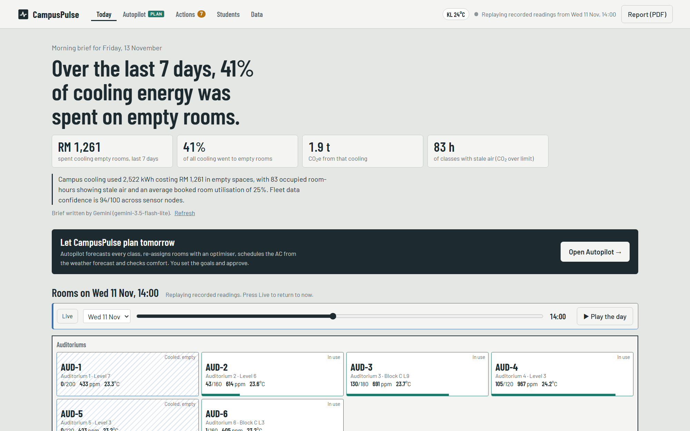
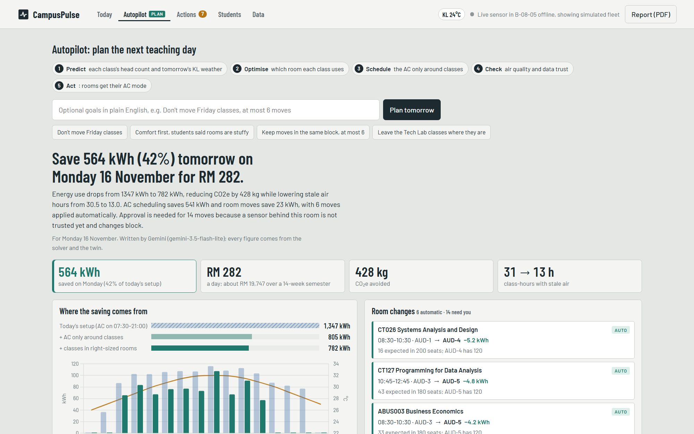
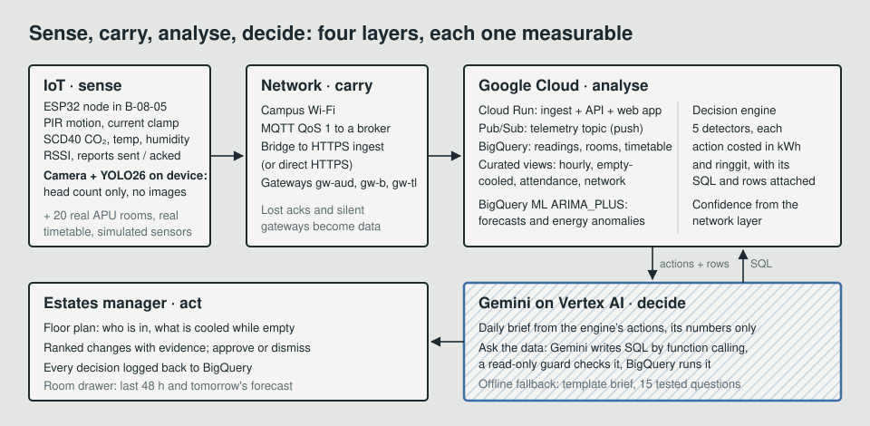

# CampusPulse

**CampusPulse plans APU's rooms and air-conditioning for the next teaching day, proves the saving, and switches the AC when Estates approves.**

APU Cloud Innovation Hackathon 2026 · Track 3: Data-Driven Research & Intelligent Decision Making

| | |
| --- | --- |
| Live demo | https://campuspulse-443933554054.asia-southeast1.run.app (Cloud Run, asia-southeast1; first load after idle takes about 10 s) |
| Demo video | Submitted with the entry (2:45) |
| Pitch deck | Submitted as a PDF with the entry |
| Virtual sensor node | [Wokwi ESP32 project](https://wokwi.com/projects/480507881128421377): press ▶, no hardware needed |



## The problem

University rooms are cooled on a fixed building schedule, not by who is in them. Classes get booked into rooms three times too big, some tutorials squeeze more students than seats into a small room, and nobody has the evidence to change the timetable or the AC with confidence. When the data does exist, nobody knows whether the sensor behind it is reliable.

CampusPulse runs on **APU's real teaching week**: 20 real rooms (Auditoriums 1–6, Block B classrooms, Tech Labs) and their actual classes, taken from APU's public timetable feed. In the demo, **empty rooms take about 41% of the week's cooling energy**, and dozens of classes with one or two intakes are booked into 120–200-seat auditoriums.

## Autopilot: the system makes the decision

Press **Plan tomorrow** and CampusPulse decides, instead of listing tips:



1. **Predict** each class's head count from the sensors (same class, past weeks) and the hourly outdoor temperature from the **real Kuala Lumpur forecast** (Open-Meteo).
2. **Optimise** which room every class uses with a mixed-integer program (SciPy / HiGHS): least cooling energy, every class fits with spare seats, no double booking, labs stay labs, a cost for every move.
3. **Schedule** each room's AC only around its classes, with a longer pre-cool on hotter mornings.
4. **Check** CO₂ stays under the limit. Trusted, small, same-block changes apply **automatically**; risky ones (a block change, an untrusted sensor, a nearly full room) **wait for a person**.
5. **Prove** it in a digital twin with the simulator's physics: today's setup vs AC schedule only vs the full plan, in kWh, RM, CO₂e and stale-air hours.
6. **Act:** approval sends each room its AC mode over MQTT; Gemini drafts the student notices; everything is logged.
7. **Learn:** the head-count forecast is checked against last week's measurements (typically within ±4 people).

Estates sets goals in plain English (*"don't move Friday classes"*, *"comfort first"*); **Gemini turns them into solver constraints** by function calling. People set the goals, the solver decides, Gemini connects the two, and no figure comes from the language model.

On the demo data a typical teaching day saves about **40% of cooling energy** and roughly halves stale-air class-hours.

## Everything else it does

1. **Morning brief.** Gemini writes a short brief from actions the decision engine has already costed: what to change, why now, the first step. It may use only the engine's numbers.
2. **What to change.** Five detectors find after-hours cooling, schedule-driven cooling of empty rooms, oversized room bookings, stale air (CO₂ over 1000 ppm) and unreliable data. Every action carries its kWh and ringgit impact, a confidence score, a chart, the rows and the exact SQL behind it. Approve or dismiss, and the decision is logged to BigQuery.
3. **Ask the data.** Plain-English questions become BigQuery SQL through Gemini function calling. A read-only guard allows one SELECT over curated views; errors go back to Gemini to fix. The answer shows the SQL, the table and a chart.
4. **Network-aware confidence.** Each node's delivery ratio (MQTT QoS 1 acknowledgements), signal strength, freshness and a stuck-sensor check become a 0–100 score. Every recommendation inherits the confidence of the rooms it touches, so a decision resting on a weak link says so.
5. **Edge AI head count.** A camera next to the room runs YOLO26 on the device and sends only the number of people, never an image. It replaces the motion sensor's guess with a real count, so "booked for 60, 9 here" becomes measured rather than estimated.
6. **What if.** Press *What if* on any change, or approve it, and the week is recalculated on the spot: kWh and ringgit saved, and how far empty-room cooling falls. The rooms involved are outlined on the floor plan.
7. **Estates report.** One-page PDF of the week's brief, ranked changes, decisions and data caveats, ready to email to Facilities (`/api/report.pdf`).
8. **Charts that explain themselves.** Each evidence chart gets a one-line caption from Gemini, written only from the chart's own numbers.
9. **Closed loop: approve, and the rooms obey.** Approving an air-conditioning change sends every room it covers its new AC mode (*follows occupancy* or *off after hours*) over MQTT on `campuspulse/<room>/command` (QoS 1, retained), or the node pulls it from `GET /api/rooms/<room>/command`. The ESP32 drives a relay on GPIO26; simulated rooms obey from their next reading, so the floor plan shows empty rooms going dark. Dismissing reverts it. Every command is listed under *Sent to the rooms*.
10. **Carbon, not just ringgit.** Every saving is also shown in kg CO₂e (grid factor `CP_GRID_KG_CO2E_PER_KWH`, default 0.758 for Peninsular Malaysia), in the brief, the actions, What if and the Estates report.
11. **Where can I study?** A student view of free rooms with no class booked for the next 30 minutes, ranked so rooms *already being cooled* come first: students fill cooling the campus is paying for anyway.
13. **Real weather.** The simulator, the planner and the header use the real hourly temperature at APU from Open-Meteo (free, no key; cached, with a typical-day fallback offline). Cooling load rises on hot afternoons.
14. **A virtual sensor node, no hardware needed.** [Open it on Wokwi](https://wokwi.com/projects/480507881128421377) (source in `firmware/wokwi/`): the node runs on the free Wokwi ESP32 simulator: DHT22, PIR, a CO₂ knob and an AC-relay LED, over real MQTT through a public broker, receiving the AC commands back. `edge/virtual_node.py` does the same from a terminal. See [docs/DEMO.md](docs/DEMO.md).
12. **Demo clock.** Replay any hour of the last 7 days (day picker, time slider, ▶ Play the day), or open `/?at=2026-11-11T14:00`. Hours when the service was down are back-filled on start, so replay never hits a hole.

## Cloud, IoT and network, converged



| Layer | What we used | Why |
| --- | --- | --- |
| IoT | ESP32 + SCD40 (CO₂, temp, RH) + PIR + optional current clamp | True NDIR CO₂ and motion for about RM 200 a room |
| Network | MQTT QoS 1 → broker → bridge → HTTPS ingest (or direct HTTPS) | Acknowledged delivery we can measure; lost reports become a signal |
| Ingest | Cloud Run, Pub/Sub push | Serverless, one container, scales to zero when idle |
| Warehouse | BigQuery: partitioned `readings`, curated views | One SQL source of truth for the app, the engine and Gemini |
| Models | BigQuery ML `ARIMA_PLUS` (occupancy forecast and energy anomalies in the room drawer) | Forecasting in SQL, no training pipeline to maintain |
| AI | Gemini (AI Studio key or Vertex AI): JSON-mode brief, chart captions, function-calling SQL agent | Explains and explores; never invents figures |
| App | FastAPI + vanilla JS + Chart.js on Cloud Run | Fast to load, nothing to build |

Locally the same BigQuery SQL runs on DuckDB, transpiled by sqlglot, so the whole system works on a laptop with no cloud account. The local forecast is an hour-of-week seasonal baseline, the same weekly pattern ARIMA_PLUS captures.

## What is real and what is simulated

- **Real, from APU:** the 20 rooms and their timetable for the week of 2 November 2026: room codes (`B-08-05` is Block B, level 8, room 05), auditorium names, module codes and names, exact class times, and how many intakes share each session. It comes from APU's public timetable feed (the data behind APSpace's timetable) via `scripts/import_apu_timetable.py`; lecturer names and accounts are dropped. The snapshot is in `campuspulse/data/apu_timetable.json`, so the app runs offline.
- **Real, our sensor:** one ESP32 node in B-08-05 (`device_id esp32-b0805`, change with `CP_LIVE_ROOM`), its readings stored with `simulated = false`. When it reports, it replaces its simulated twin on the floor plan, marked "live".
- **Simulated:** sensor readings for the other rooms, 28 days at 5-minute intervals, labelled `simulated = true` everywhere. The simulator follows the real timetable and uses a CO₂ mass balance, a thermal model and AC load. On top of what the real timetable produces (small classes in auditoriums, crowded shared sessions, cooling between classes), it plants Friday-afternoon no-shows, weekend AC left on in Auditorium 2, a weak link in Tech Lab 7-01, a stuck CO₂ sensor in Tech Lab 4-02 and a four-hour Tech Lab gateway outage. The tests check that the engine finds every one of them without being told.
- **Assumptions:** APU does not publish room capacities, AC loads or enrolment, so seats (auditoriums 120–200, classrooms 50, Tech Labs 40) and AC loads are estimates, and class size is estimated as 12 students per intake sharing a session, capped at the room's seats. Energy price `CP_TARIFF_RM_PER_KWH` defaults to RM 0.50/kWh; set it from the current TNB commercial tariff before presenting. All of these live in `campuspulse/campus.py` and `.env`, ready to replace with Estates data.

## Edge camera: count people with YOLO (optional)

The camera node lives in `edge/` and is installed separately, so the main app stays light and MIT-licensed (Ultralytics is AGPL-3.0).

```bash
python -m pip install -r edge/requirements.txt
python edge/people_counter.py --room B-08-05 --show      # Mac webcam, local preview window
```

- **Privacy by design:** frames are processed on the device and never saved or sent. Only `{room, people}` goes to `/api/ingest`. The preview window (`--show`) is local.
- **A phone as the camera:** run an IP-camera app on the phone and pass its stream, e.g. `--source http://192.168.1.23:8080/video`.
- **Deployed app:** add `--server https://<your-cloud-run-url> --key <CP_INGEST_KEY>`.
- **Network-aware:** reports that fail are queued and retried; each report says how many attempts it took, so the camera gets its own delivery score in *Can we trust the data?*.
- **Test without a camera:** `python edge/people_counter.py --image photo.jpg --save boxes.jpg`.
- On a Mac, the first run asks for camera permission for your terminal (System Settings → Privacy & Security → Camera). The YOLO26 nano weights (about 5 MB) download on first run.

## How robust is the auditorium finding?

Class size is the one estimate the room moves depend on, so we stress-tested it against APU's real timetable for the week (91 auditorium classes):

| Assumed students per intake | Auditorium classes under 35% full |
| --- | --- |
| 12 (our default) | 46 |
| 20 | 36 |
| 30 | 23 |
| 40 | 14 |

The finding does not depend on the estimate: **34 of the 91 auditorium classes are for one or two intakes in APU's own timetable, and 14 are for a single intake.** When Facilities shares real seat counts or AC loads, put them in `campuspulse/data/room_overrides.csv` (copy the `.example.csv`) and restart; nothing else changes.

## Run it locally (2 minutes)

```bash
python -m pip install -r requirements.txt
python -m uvicorn campuspulse.api:app --port 8080
# open http://localhost:8080
```

The first start seeds 28 days of history (about 5 seconds). Without a Gemini key the brief is templated and Ask works on the 15 tested questions. To switch Gemini on, copy `.env.example` to `.env` and set `GEMINI_API_KEY` (AI Studio), or `CP_GEMINI_VERTEX=true` and `GOOGLE_CLOUD_PROJECT` for Vertex AI. The app reads `.env` on start; it is git-ignored. Run `python scripts/check_gemini.py` to test the key and model; it prints Gemini's own error if something is wrong.

Send a reading as the physical node would:

```bash
curl -X POST localhost:8080/api/ingest -H 'X-Device-Key: dev-ingest-key' -H 'Content-Type: application/json' \
  -d '{"device_id":"esp32-b0805","room_id":"B-08-05","occupied":true,"co2_ppm":812,"temp_c":24.6,"rssi_dbm":-61,"watts":2100}'
```

## Deploy to Google Cloud (free tier)

```bash
gcloud auth login && gcloud auth application-default login
PROJECT_ID=your-project ./deploy/deploy.sh
python scripts/cloud_check.py        # PASS/FAIL for every query on BigQuery and every endpoint
```

The script enables the APIs, creates a service account, builds the BigQuery dataset, views and 28 days of history, trains the two BigQuery ML `ARIMA_PLUS` models, creates the Pub/Sub topic and push subscription, and deploys Cloud Run. Gemini uses `GEMINI_API_KEY` from your `.env` (AI Studio) if set, otherwise Vertex AI. The ingest key and service URL are saved to `.deploy.env` (git-ignored); redeploy without retraining with `SKIP_ML=1`.

It is sized to stay inside the Google Cloud free tier:

| Service | Setting | Free tier (per month) |
| --- | --- | --- |
| Cloud Run | scales to zero, CPU billed only during requests, one instance | 2 M requests, 180,000 vCPU-seconds |
| Simulated readings | produced on the next request (catch-up), not by a background loop | |
| BigQuery | live queries anchored on a constant time, so they read recent partitions only; shared 20-second cache; the dashboard stops polling in hidden tabs | 1 TiB queries, 10 GiB storage |
| BigQuery ML | trained once with a 30-day horizon; the room drawer reads `ML.FORECAST` | |
| Pub/Sub | readings flow ingest → topic → push subscription → BigQuery | 10 GiB messages |
| Gemini | AI Studio key, with retries on "high demand" errors | free tier of the model |

The first request after an idle spell takes about 10 seconds while the service wakes up. Refresh the timetable to another week with `python scripts/import_apu_timetable.py --week YYYY-MM-DD` (a Monday). Firmware setup is in [firmware/README.md](firmware/README.md).

## Repository

```
campuspulse/        service: simulator, store (BigQuery | DuckDB), analytics, network, decisions
campuspulse/agent/  Gemini brief, SQL agent, read-only SQL guard, tested questions
campuspulse/data/   APU timetable snapshot (public feed, no lecturer data)
bigquery/           schema, curated views, BigQuery ML
web/static/         dashboard
firmware/           ESP32 node (MQTT QoS 1 or HTTPS)
edge/               YOLO people counter (camera node, optional)
deploy/, scripts/   Cloud Run deploy, BigQuery setup
tests/              41 tests: guard, engine finds planted problems, API, camera, control, cloud paths (BigQuery ML, Pub/Sub, catch-up), Gemini loop
```

## API

| Method | Path | Purpose |
| --- | --- | --- |
| POST | `/api/ingest` | Node readings (header `X-Device-Key`) |
| POST | `/api/pubsub/push` | Pub/Sub push target |
| GET | `/api/overview` | KPIs, room states, mode |
| GET | `/api/brief` | Gemini brief + ranked actions (`?refresh=true`) |
| POST | `/api/actions/{id}/decide` | Approve or dismiss; logged to `decisions` |
| GET | `/api/rooms/{id}` | 48 h history, 24 h forecast, anomalies |
| GET | `/api/network` | Node confidence and gateway outages |
| POST | `/api/ask` | Ask the data |
| GET | `/api/actions/{id}/caption` | One-line chart caption |
| GET | `/api/report.pdf` | One-page Estates report |
| GET | `/api/overview?at=…` | Floor plan and study rooms replayed at a past local time |
| POST | `/api/autopilot/plan` | Plan the next teaching day; body `{"instructions": "..."}` (plain-English goals) |
| POST | `/api/autopilot/apply` | Carry out a plan: `{"plan_id": "...", "approve_review": false}` |
| GET | `/api/autopilot/latest` | The last plan |
| GET | `/api/commands` | Device commands sent for approved changes, and each room's AC mode |
| GET | `/api/rooms/{id}/command` | HTTPS pull of the room's AC mode (header `X-Device-Key`) |

## Tests

```bash
python -m pytest -q
```

## Team

Team **What's Google?**: Shermaine Yap Shi Min, Asia Pacific University of Technology & Innovation.

MIT licensed.
